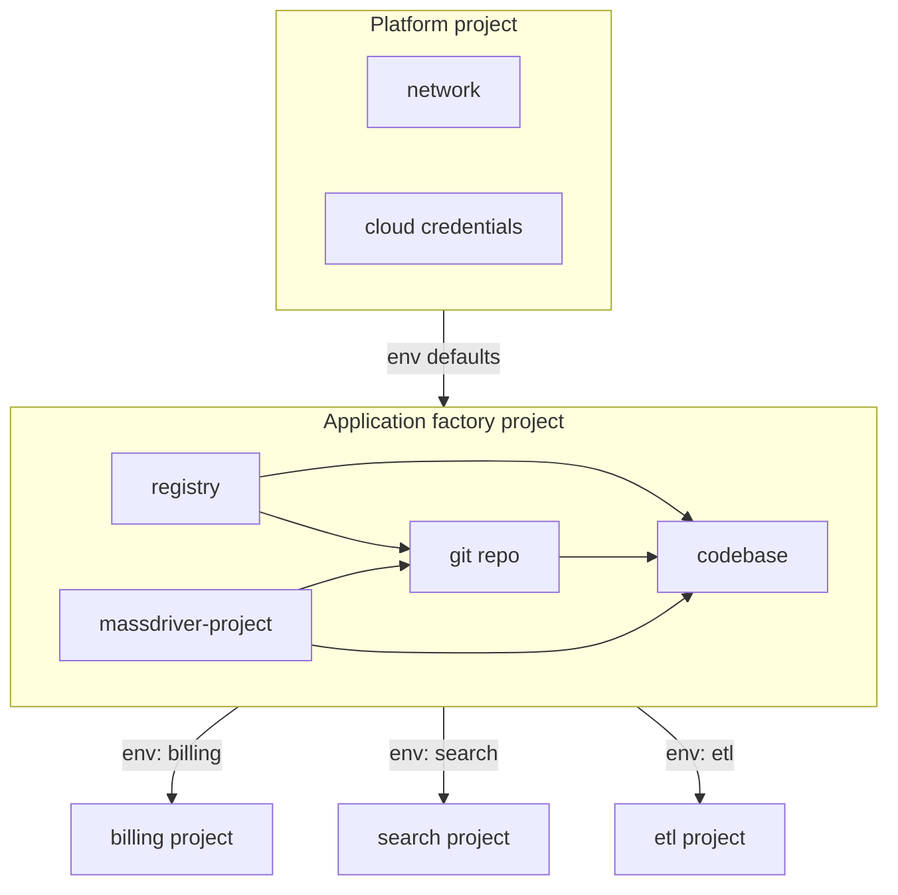
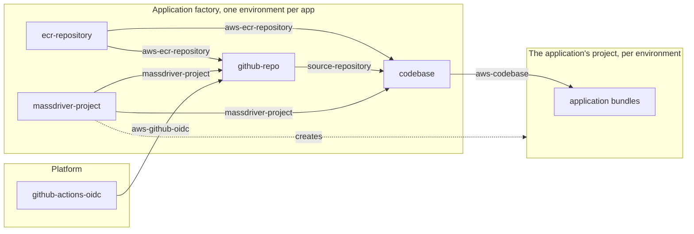

# Massdriver Project Factory: AWS and GitHub

A Massdriver catalog for minting applications on AWS and GitHub. The factory is itself a Massdriver project: its canvas holds an ECR repository, a GitHub repository and a Massdriver project, and every environment of the factory is one application. Adding an environment stamps out another application's project, repository and registry, already wired together, with a pipeline that can build, push and deploy into the new project on its first merge.

## The pattern



Each factory component has one job:

- **Registry** holds the application's images.
- **Massdriver project** creates the application's project and its environments, and the group its pipeline deploys with.
- **Git repo** creates the repository and gives its pipeline what it needs to push to the registry and deploy into the project. It depends on the other two because the pipeline needs somewhere to push and something to deploy.
- **Codebase** merges the repository, the registry and (optionally) the project into one resource, and shares it with the minted project. Set as an environment default there, it hands every application bundle the repository and registry without links across projects.

The factory's own environment defaults come from the platform project, so every application it mints is built with the platform's credentials and network.

### What a platform team gets

- One place to say "create these for this team": registry, repository, project, pipeline identity and group.
- Registry policy, repository settings and who can deploy are set once per application, in one view, instead of across three tools.
- Changing the pattern (a new scanner, a new pipeline template, a different IAM shape) is a change to a factory bundle, rolled out environment by environment, which here means application by application.

- Pipelines that can only deploy where the project says: each repository's pipeline gets its own Massdriver service account, in a group scoped to its own project and to the environments listed on the form.
- No cloud keys in GitHub: the pipeline pushes to ECR through GitHub's OIDC tokens, on a role only that repository's default branch can assume.

From the factory, the environment list is the inventory of applications:

```
  Application factory project, environments

  env            project-type   project          team
  billing        app-hosting    billing          payments
  search         app-hosting    search           discovery
  etl            etl            etl              data
```

From inside a minted application, the factory environment is where its repository, registry and pipeline identity come from, and Massdriver's dependency view can walk from the application back through the factory to the platform.

### The codebase resource

The application's project gets one resource from the factory, `aws-codebase`, set as an environment default on each of its environments:

```yaml
repository:            # the same shape for any Git host
  full_name: acme/billing
  url: https://github.com/acme/billing
  clone_url: https://github.com/acme/billing.git
  ssh_url: git@github.com:acme/billing.git
  default_branch: main
  visibility: private
registry:              # the ECR repository, with policies to attach
  name: factory-billing-registry
  arn: arn:aws:ecr:us-east-1:123456789012:repository/factory-billing-registry
  registry_id: "123456789012"
  url: 123456789012.dkr.ecr.us-east-1.amazonaws.com/factory-billing-registry
  region: us-east-1
  policies:
    - { name: push, arn: arn:aws:iam::123456789012:policy/factory-billing-registry-push }
    - { name: pull, arn: arn:aws:iam::123456789012:policy/factory-billing-registry-pull }
# project: ...         # declared, commented out; see below
```

It is one resource rather than two because every bundle in the application's project needs the same repository and registry, in every environment. As an environment default it is set once per environment and reaches every bundle there, instead of a link per instance across projects. A function attaches the registry's pull policy to its role and runs `registry.url:<git-sha>`; a bundle that opens issues or reads the code uses `repository`.

### Why "codebase"

The resource the minted project consumes describes where an application's code lives and where its builds go: the repository, the registry, and how CI reaches both. That is the application's codebase, the name Massdriver's reference layouts give the project that holds repositories and registries. "Delivery" describes the pipeline's activity rather than the thing it delivers from, and "landing zone" already means an account baseline.

### The project field

The codebase resource type declares the Massdriver project as a commented-out field. Bundles that consume a codebase already run inside the project it describes, so repeating it adds a second source of truth. Uncomment it in the resource type and the codebase bundle if your application bundles need the project's identifier or environment list.

## Recommended attributes

Massdriver attributes are key-value tags on projects and environments. Group policies match on them, and the global and dependency views filter on them. Each key must be defined for the organization before a project or environment can carry it.

| Attribute | On | Example values | Why |
|---|---|---|---|
| `project-type` | Projects | `platform`, `ci`, `app-hosting`, `etl` | Filters the global view down to one kind of project, and scopes policy by kind: a CI group can deploy in `ci` projects and only propose elsewhere. The factory is `ci`; the projects it mints are `app-hosting` or `etl`. |
| `team` | Projects, environments | e.g. `payments`, `search` | Names the owner. Policies grant a team's group configure and deploy where `team` matches, and the dependency view can show who to ask at a permission boundary. |
| `application` | Factory environments, minted projects | e.g. `billing` | Ties a factory environment to the project it minted, so both sides filter to the same application and policies can follow it across the two. |

Massdriver also sets `md-project` and `md-environment` on everything. Use them alongside these: `md-environment` for "deploy to dev only", `project-type` and `team` for "which projects at all".

Keep values short and lowercase. They appear in policy conditions, so a renamed value is a policy change.

## Other clouds and Git hosts

The pattern doesn't depend on AWS or GitHub. A Google Cloud variant swaps ECR for Artifact Registry and the OIDC role for workload identity federation; an Azure variant swaps in Azure Container Registry and a federated managed identity. A GitLab variant replaces the GitHub repository bundle. The Massdriver project bundle and the shape of the codebase resource stay the same.

## AWS and GitHub

### Bundles

| Bundle | What it is |
|---|---|
| `ecr-repository` | The application's container image repository, with push and pull policies |
| `massdriver-project` | The application's Massdriver project, its environments, and a group that can deploy in the ones the pipeline ships to |
| `github-repo` | The application's GitHub repository, with a pipeline that pushes to the ECR repository through GitHub's OIDC tokens and deploys into the project with its own service account |
| `codebase` | The repository and ECR repository merged into one `aws-codebase` resource, shared with the application's project |
| `github-actions-oidc` | The AWS account's trust in GitHub Actions' tokens. Once per account, in the platform project |

### Resource types

| Resource type | What it carries |
|---|---|
| `aws-ecr-repository` | An ECR repository's URL and its push and pull policies |
| `massdriver-project` | A project's identifier, environments and deploy group |
| `source-repository` | A Git repository's URLs and default branch, the same for any host |
| `aws-codebase` | Repository and registry together; an environment default in the application's project |
| `aws-github-oidc` | The account's GitHub Actions OIDC provider |

Credentials: **AWS IAM Role** (`aws-iam-role`), which every AWS bundle deploys with; **GitHub App** (`github-app`), which creates repositories and sets their variables and secrets; and **Massdriver Service Account** (`massdriver-service-account`), which creates projects, groups and pipeline identities and shares the codebase. All three are environment defaults on the factory.

### How bundles connect



Arrows into and out of the factory are environment defaults, not links. The codebase reaches the application's project because it is shared with every environment whose `md-project` is that project; it still has to be set as each environment's default there, since the Massdriver Terraform provider can't set environment defaults yet.

## Shared modules

`modules/` is for OpenTofu shared across cloud variants. A published bundle contains only its own directory, so bundles source modules as `./modules/<name>` and `make modules` copies `modules/` into each bundle that uses one, before build and publish. The copies are not committed.

## Repository layout

```
platforms/        Credential types
resource-types/   Contracts between bundles
bundles/          OpenTofu bundles
modules/          OpenTofu shared by bundles
bootstrap/        The factory project and its canvas, from one terraform apply
.github/workflows Publishing
```

## Getting started

1. **Publish from GitHub Actions.** First turn on **Settings → General → Grant new bundle repositories to all projects**, or projects can't use what you publish. Create a Massdriver service account with a **1 year** token in a group allowed to publish to the catalog. In the repository's **Settings → Secrets and variables → Actions**, add its key as the secret `MASSDRIVER_API_KEY` and your organization ID as `MASSDRIVER_ORG_ID` (a variable or a secret). Then run **Actions → Publish → Run workflow** with *all* ticked. After that, every push to `main` publishes whatever changed since the last successful publish: credential types and resource types first, then bundles.
2. **Define the attributes** above in your organization's settings.
3. **Add credentials** in Massdriver, following the instructions on each credential's form, and set them as defaults on the factory's environments.
4. **Deploy `github-actions-oidc`** once per AWS account in the platform project, and set its resource as a default on the factory's environments.
5. **Create the factory project**, tagged `project-type: ci`, and put the registry, Massdriver project, Git repo and codebase bundles on its canvas, linked. [bootstrap/](bootstrap/) does this.
6. **Add an environment per application**, tagged with its `application` and `team`, and deploy it.
7. **Set the new project's environment defaults:** its cloud credentials, network, and the codebase.

## Versioning

Everything publishes as `0.0.0`, which can be republished in place for bundles and resource types alike. Publishing any other version to a repository ends that, development releases included: once a repository holds another version, `0.0.0` can no longer be overwritten there, and the next change needs a version bump.

## License

[Apache License 2.0](LICENSE).
