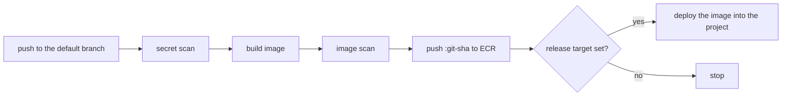

# GitHub Repository

An application's repository in the connected GitHub organization, created through the GitHub App, with a pipeline that can push to the application's ECR repository and deploy into its Massdriver project.

## How it connects

It depends on the factory's other two components:

- **ECR repository:** the pipeline pushes there. This bundle makes an IAM role only the default branch of this repository can assume, through GitHub's OIDC tokens, with the ECR repository's push policy attached. No AWS keys are stored in GitHub. The role trusts the account's GitHub Actions OIDC provider, which the factory gets as an environment default from the platform.
- **Massdriver project:** the pipeline deploys there. This bundle makes a Massdriver service account for the repository and puts it in the project's deploy group, so the pipeline can deploy only where that group can. Its token is the `MASSDRIVER_API_KEY` Actions secret, valid for a year. The first deploy after eleven months replaces the service account and the secret with fresh ones, so redeploy at least that often.

The repository resource it produces describes the repository the same way any Git host would, so the codebase bundle can merge it with the registry and project.

## The pipeline

With **Add the pipeline** on, the repository starts with two workflows.

`build.yml` runs on every pull request and every push to the default branch: it scans the whole history for committed secrets with gitleaks, builds the image for **Image platform**, and scans it with Trivy, failing on any critical vulnerability that has a fix. On the default branch it then pushes the image to ECR tagged with the commit SHA. Until the repository has a Dockerfile at its root, only the secret scan runs.

`release.yml` follows each successful build on the default branch. With **Release to environment** and **Release component** set, it deploys `<project>-<environment>-<component>` with **Image param** set to the new image. Without them it does nothing, so release can be turned on later without touching the workflow.

Both read Actions variables this bundle keeps current: `AWS_REGION`, `AWS_ROLE_ARN`, `IMAGE_REPOSITORY`, `MASSDRIVER_ORGANIZATION_ID`, `MASSDRIVER_URL`, `MASSDRIVER_PROJECT`, and, with a release target, `MASSDRIVER_RELEASE_INSTANCE` and `MASSDRIVER_IMAGE_FIELD`. The workflow files are written once, when the repository is created, and then belong to the team.

## Visibility

Private repositories are visible to the organization's members and use GitHub Actions minutes from the plan's allowance. Internal repositories are visible to every member of the enterprise. Public repositories are visible to everyone and build free.

## Adopting an existing repository

Turn on **Adopt an existing repository** on the first deploy to manage a repository that already exists in the organization, with **Repository name** set to its name. Nothing in it is overwritten and the workflows aren't committed, but the variables and secret above are set; delete any that already exist first. An archived repository is unarchived.

## Decommissioning

The repository is archived, not deleted, so the code survives. The name stays taken until the archived repository is deleted or renamed on GitHub. The push role and the pipeline's service account are deleted.
